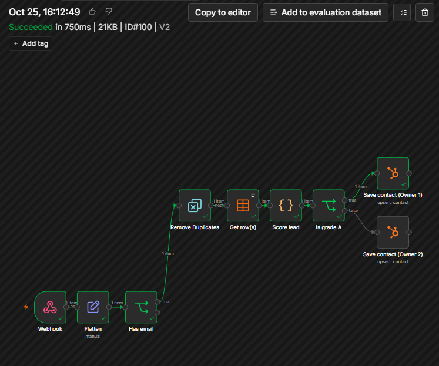
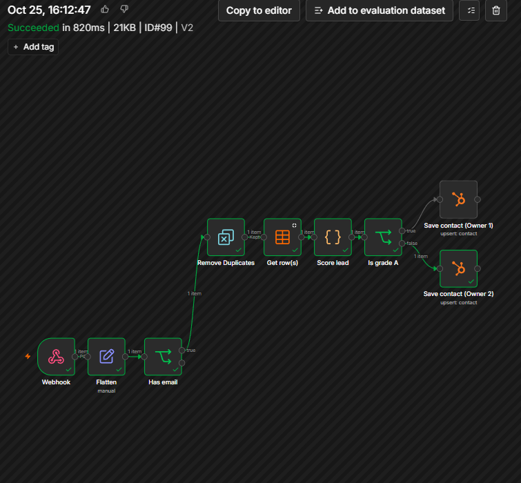
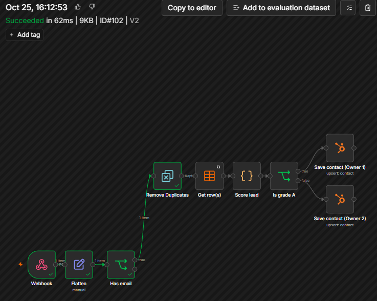
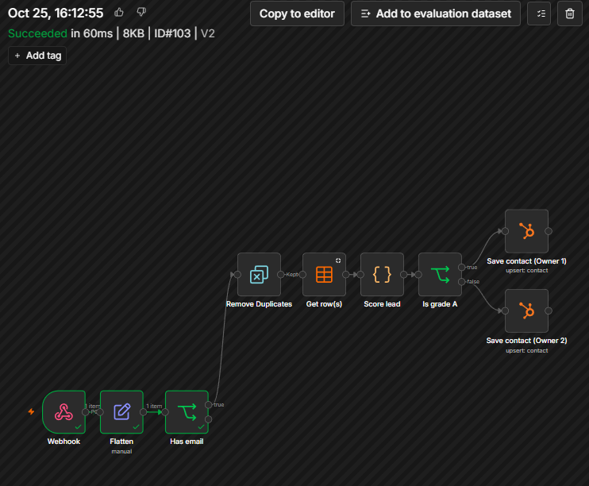
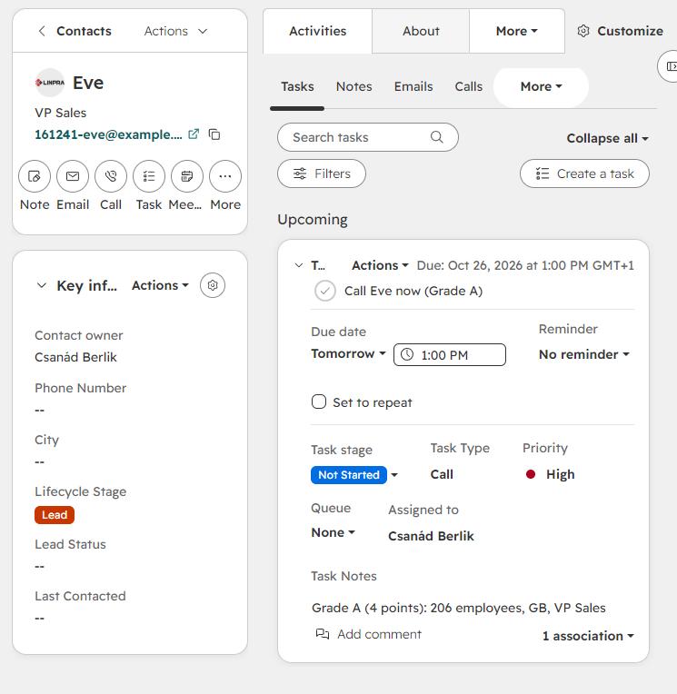
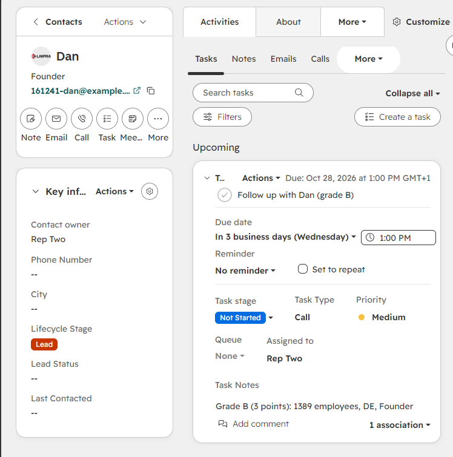
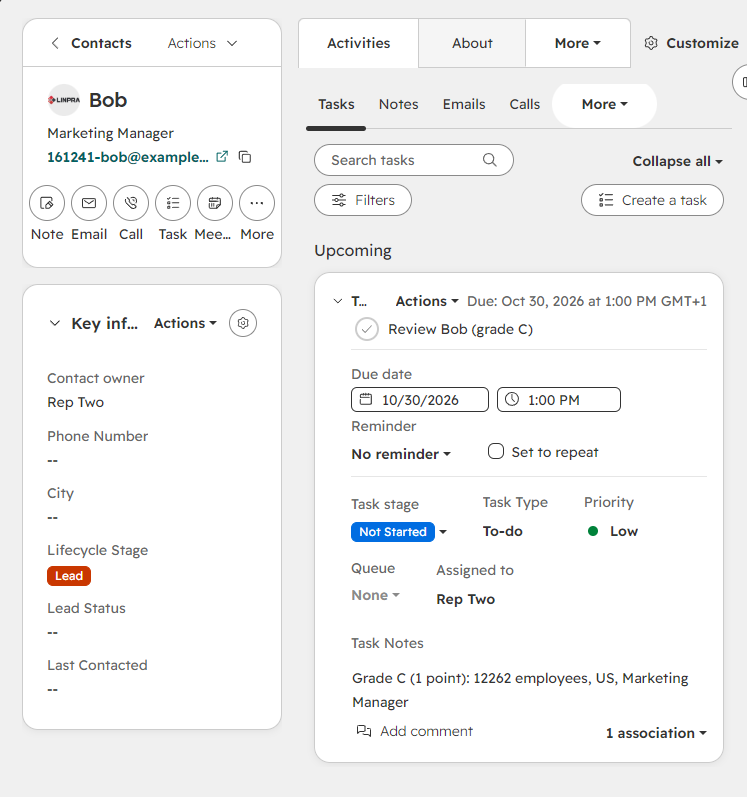
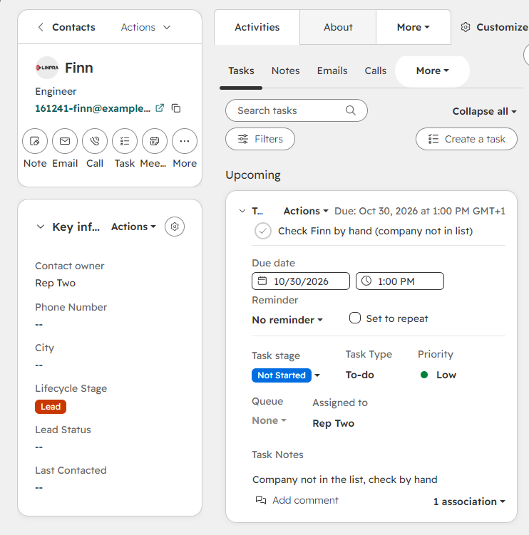
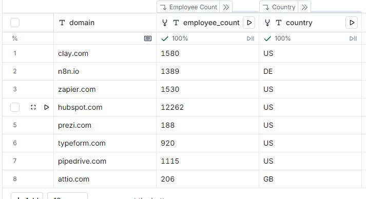

# lead-routing-n8n

A new lead should reach the right person with a clear reason and a deadline. Done by hand, that means someone reads each form fill, guesses how good the company is, and assigns it. This n8n workflow does that step from written rules: it grades the lead A, B, C or Unknown from company size, country and job title, picks an owner from the grade, and saves the contact in HubSpot with the grade and a one-line reason. A HubSpot workflow then creates a task for the owner, with a priority and due date that depend on the grade.

Built and tested on made-up leads against a HubSpot developer test account. There is no real traffic and no client behind it. Everything taken on trust is listed under [Assumptions and limits](#assumptions-and-limits).

## What is in here

| File | |
|---|---|
| `lead-routing.public.json` | the n8n workflow, with IDs, the webhook path and the owner IDs replaced by placeholders |
| `companies.csv` | the company table as Clay returned it, eight rows, unedited |
| `replay.sh` | sends nine sample leads and prints what each should do |
| `docs/screenshots/` | n8n executions, HubSpot tasks and the Clay table from the replay |
| `README.md` | this file |

No secrets are in the repository. The webhook secret and the HubSpot key live in n8n credentials.

## The rules

The leads are people. The company data comes from a table of real company domains that I enriched in Clay (employee count and country). Both rules and numbers are my own starting point, not tuned on anything.

| Signal | Points |
|---|---|
| 51 to 500 employees | 2 |
| 11 to 50 or 501 to 2000 employees | 1 |
| Any other size | 0 |
| Country is US, GB, DE or NL | 1 |
| Job title contains founder, chief, VP, vice president, head or director (whole word, any case) | 1 |

| Points | Grade | Owner | Task in HubSpot |
|---|---|---|---|
| 4 or more | A | Owner 1 | Call, High, due next business day |
| 2 or 3 | B | Owner 2 | Call, Medium, due in 3 business days |
| 0 or 1 | C | Owner 2 | To-do, Low, due in 5 business days |
| Company not in the table | Unknown | Owner 2 | To-do, Low, due in 5 business days, "check by hand" |

A lead without an email is dropped.

## How it works

```
POST /webhook/<path>   header X-Lead-Secret
  wrong secret                  -> 403, no run starts
  Flatten                       lead_id, email, first_name, job_title, domain
  Has email                     no email                    -> stop
  Remove Duplicates             lead_id already seen        -> stop
  Get row(s)                    companies table, match on domain (Always Output Data on)
  Score lead                    Code node: points, grade, reason
  Is grade A                    yes -> Save contact (Owner 1), no -> Save contact (Owner 2)
HubSpot workflow: Routing reason changed -> branch on Lead grade -> Create task for the contact owner
```

`Save contact` is the HubSpot node, Contact, Create or Update, keyed on email. It writes the owner, `lead_grade` and `routing_reason`. The reason reads like `Grade A (4 points): 206 employees, GB, VP Sales`, and the task notes show the same text.

The workflow does not create tasks itself. The service key I used has no task scope, so a HubSpot workflow does it, the same way as in my [signal-alert-n8n](https://github.com/Csanad-Berlik/signal-alert-n8n) project.

n8n answers `200` ("Workflow was started") before any check runs, so the HTTP code only says the lead was received. Open Executions in n8n to see where a run ended. n8n shows a run that was dropped by a check as "Succeeded".

## Set it up

Tested on n8n 2.43.8 in Docker (WSL) and a HubSpot developer test account.

1. **Two users in HubSpot.** Owner 1 and Owner 2 need to be different users, or routing shows nothing. A developer test account lets you add a second one.
2. **HubSpot properties on Contact.** `lead_grade` (dropdown: A, B, C, Unknown) and `routing_reason` (single-line text).
3. **HubSpot service key** with scopes to read and write contacts, and to read owners. Make sure they are the contacts scopes, not the contracts ones, which sit next to them in the list.
4. **Companies table.** An n8n data table `companies` with `domain` (text), `employee_count` (number) and `country` (two-letter code, text). Import `companies.csv`, which is the table I exported from Clay. Extra columns are fine.
5. **Credentials in n8n.** Header Auth with header name `X-Lead-Secret` and a secret of your choosing. HubSpot with credential type Service Key.
6. **Import** `lead-routing.public.json`. Re-select the credentials and the data table on the nodes that show a warning, set a webhook path, and put each user's numeric owner ID in the `Contact Owner` field of the two `Save contact` nodes. I have not re-imported this exact file into a fresh n8n, so expect to fix a field or two.
7. **HubSpot workflow.** Contact workflow, trigger "Property value changed" on `routing_reason`, condition "is known", re-enrollment on. Add a "Branch based on property value" on `lead_grade` with the outputs A, B, C and Unknown. In each branch add "Create task", assigned to the contact owner, with the `routing_reason` token in the notes. Set the type, priority and due date from the table above. Choose to enrol only records that meet the criteria after the workflow is turned on.
8. **Publish** the n8n workflow. Until it is published, the production URL returns 404. The Execute button only runs one manual test.

## Replay

```bash
WEBHOOK_URL=http://localhost:5678/webhook/<path> LEAD_SECRET=<secret> bash replay.sh
```

Each run uses a new tag (the time, by default) in the lead IDs and emails, because Remove Duplicates remembers every lead ID it has seen. Every run creates new contacts in HubSpot. The `companies` table needs rows for prezi.com, hubspot.com, n8n.io and attio.com. `notinlist.example` must not be in it.

HubSpot creates each task about a minute after the contact is saved.

### Results

Run on the published workflow. I compared the n8n Executions and the HubSpot contacts and tasks by hand against this table.

| # | Lead | Title, company | Expected | Result |
|---|---|---|---|---|
| 1 | Alice | Head of Sales, prezi.com (188 employees, US) | A, 4 points, Owner 1, High call, next business day | as expected |
| 2 | Bob | Marketing Manager, hubspot.com (12262, US) | C, 1 point, Owner 2, Low to-do, 5 business days | as expected |
| 3 | Cleo | Sales Rep, prezi.com (188, US) | B, 3 points, Owner 2, Medium call, 3 business days | as expected |
| 4 | Dan | Founder, n8n.io (1389, DE) | B, 3 points, Owner 2, Medium call, 3 business days | as expected |
| 5 | Eve | VP Sales, attio.com (206, GB) | A, 4 points, Owner 1, High call, next business day | as expected |
| 6 | Finn | Engineer, company not in the table | Unknown, Owner 2, Low to-do, "check by hand" | as expected |
| 7 | Alice again | same lead ID as 1 | stops at Remove Duplicates, no second contact or task | as expected |
| 8 | Gus | no email | stops at Has email, nothing written to HubSpot | as expected |
| 9 | Nina | wrong secret | 403, no run starts | as expected |

The employee counts are what Clay returned. See below.

### Screenshots

Executions in n8n, on version 2 of the workflow. A run that stops early shows green only up to the node where it stopped.

| Grade A goes to Owner 1 (Eve, #100) | Grade B goes to Owner 2 (Dan, #99) |
|---|---|
|  |  |
| **Duplicate stops at Remove Duplicates** | **No email stops at Has email** |
|  |  |

Tasks that HubSpot created, one per grade. Each task has its own type, priority, due date and owner, and the notes carry the reason from the workflow.

| A (Eve): call, High, Owner 1 | B (Dan): call, Medium, Owner 2 |
|---|---|
|  |  |
| **C (Bob): to-do, Low, Owner 2** | **Unknown (Finn): to-do, Low, Owner 2** |
|  |  |

The Clay table the company data came from (see the limits below on how far to trust it):



The other runs and tasks (Alice, Bob, Cleo, Finn) are in `docs/screenshots/`.

## Assumptions and limits

- **The leads are made up.** The people are invented and use `example.org` addresses. The companies are real domains, but no one at those companies is involved.
- **The Clay data is wrong in places.** The headcounts and countries in `companies.csv` are whatever Clay's enrichment returned (8 credits for the eight rows). A rough comparison against public estimates, which I have not verified source by source, suggests several counts are too high: HubSpot is listed at 12262 but reports about 9000 full-time employees, and n8n, Zapier, Typeform and Pipedrive look high too. Typeform is listed as US but is headquartered in Spain. I left the data as returned, so the replay results below match this table. For the four companies the replay uses, the corrected numbers would land in the same size band, so the grades would not change. Treat the numbers as sample data, not facts about those companies. In a real setup I would use size ranges instead of exact counts, because exact counts go stale and differ between sources.
- **The owners are two test users** in a HubSpot developer test account. No real salespeople.
- **The rules are untuned.** The point values and the A, B, C cutoffs are my guess. A real team would adjust them from which leads actually convert. Nothing here measures that.
- **An existing owner is not respected.** The workflow sets the owner on every run, so a contact that already exists in HubSpot gets its owner replaced. I did not build or test a "keep the current owner" rule.
- **A repeat lead may not make a new task.** The HubSpot workflow starts when `routing_reason` changes. A second lead with the same email and the same reason text should not start it again. I did not test this.
- **Leads without an email are dropped silently.** Nothing is logged or sent anywhere.
- **The company match is exact.** The lookup uses the `domain` field of the lead against the `companies` table. A domain written differently (`www.`, capitals) shows up as Unknown.
- **Remove Duplicates keys on `lead_id`, not on email.** Two lead IDs with the same email save the same contact twice.
- **The webhook secret** is a practice value. Use a new one before pointing anything real at it.
- **Test accounts expire.** A HubSpot developer test account expires after 90 days without an API call.
